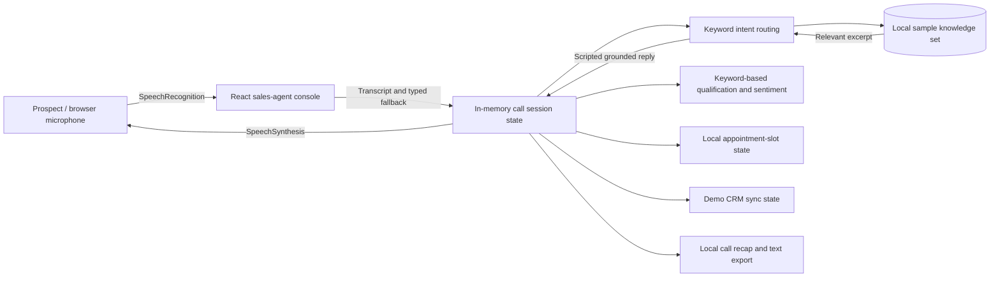
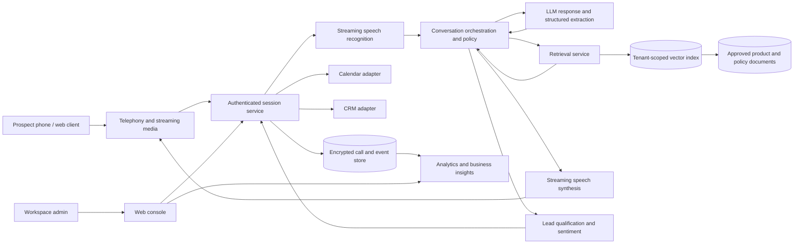

# System Architecture

## MVP request and data flow

The prototype runs entirely in the browser. The microphone and speaker are browser APIs; transcript, local knowledge, booking confirmation, CRM handoff, and sample insights are client-side demonstration logic. No call audio or lead data is sent to an external service.

## Production target architecture

## Trust boundaries and production requirements

- Keep provider credentials in server-side secret storage; never ship API keys in the browser bundle.
- Authenticate and authorize tenant access before session, transcript, knowledge, CRM, or calendar operations.
- Scope retrieval and persistence by tenant and document permissions; log source IDs for every generated answer.
- Obtain recording/transcription consent, apply configured retention/deletion policies, and redact sensitive fields where required.
- Use idempotent CRM/calendar writes, retries with limits, audit events, and a human handoff path.
- Track latency, speech recognition errors, retrieval grounding, model refusals, booking outcomes, and qualified-meeting conversion.
